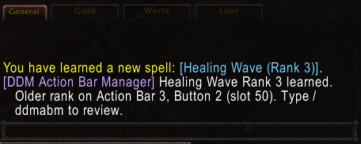
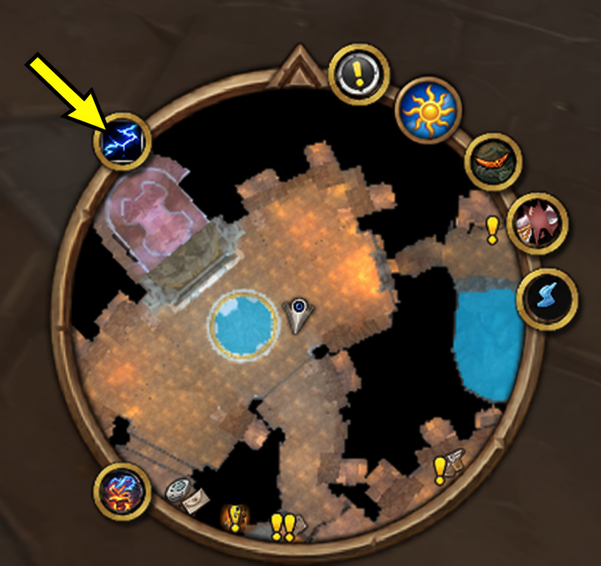
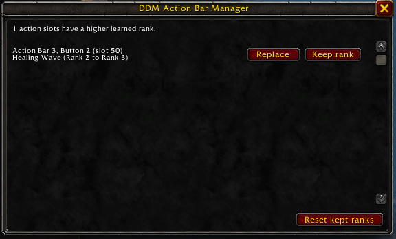

# DDMActionBarManager

Part of a set of [WoW: Forever tools](https://github.com/thechainercygnus).

Find outdated spell ranks on your **World of Warcraft: Forever** action
bars and upgrade them to the highest rank your character has learned.
Keep intentional downranks on the buttons where you use them.

## What it does

- Scans all eight standard action bars, including hidden bars and alternate
  pages. Each result shows the bar, button, current rank, and available rank.
- Alerts you in chat when you learn a higher rank and still have an older
  rank on a bar.
- Replaces a spell in the same slot, so you can keep using the same button
  or keybind.

The addon checks spells placed directly on action bars. Macros, items, and
pet actions are outside its scope.

## In-game examples

### New rank alert

After you learn Healing Wave Rank 3, the chat alert points to the button
that still has Rank 2.

### Rank upgrade window

Left-click the **DDM Action Bar Manager** minimap icon to review your
spell ranks. Look for the blue lightning bolt at the upper left of the
minimap in this example.

Choose **Replace** to upgrade Healing Wave to Rank 3 or **Keep rank** to
leave Rank 2 on that button.

## Install on Windows

1. **Close WoW: Forever.** Leave the Battle.net app open.
2. **Unzip the addon.** Open your Downloads folder, right-click the addon
   ZIP file, choose **Extract All**, then click **Extract**. In the extracted
   files, find the folder named **DDMActionBarManager**. If you open it, you
   should see **DDMActionBarManager.toc** and **DDMActionBarManager.lua**.
   If you see another folder with the same name, use the inner folder.
3. **Find the game's AddOns folder.** In Battle.net, select the
   **WoW: Forever** game version you play. Click the gear next to **Play**
   and select **Show in Explorer**. If it opens the main World of Warcraft
   folder, open the folder for your Forever installation. Then open
   **Interface**, followed by **AddOns**.
4. **Copy the addon into the game.** Go back to the extracted
   **DDMActionBarManager** folder, right-click it, and choose **Copy**.
   Return to the game's **AddOns** folder, right-click an empty space, and
   choose **Paste**. The folder you just pasted should contain the two
   files from step 2 directly.

   The finished location should look like this:

       Interface\AddOns\DDMActionBarManager\DDMActionBarManager.toc

5. **Start the game and check it loaded.** On the character selection
   screen, click **AddOns** and make sure **DDMActionBarManager** is checked.
   Log in and left-click the addon's blue lightning bolt icon on the
   minimap. If the rank window opens, the addon loaded successfully,
   even if the list is empty.

**If the addon is missing:** Check that you copied it into the **AddOns**
folder for the same game version you launched. Then open the pasted
**DDMActionBarManager** folder and check that it contains the addon files
directly, with no extra folder in between.

## Quick start

1. Left-click the minimap icon to see which spells can be upgraded.
2. Choose **Replace** to upgrade a slot while out of combat with an empty
   cursor. Choose **Keep rank** to retain an intentional downrank on that
   slot. **Reset kept ranks** clears those choices for your character.
3. Right-click the minimap icon and open **Settings**.

Left-drag the minimap icon to reposition it. Its position, your settings,
and your kept ranks are saved per character.

## Settings

| Setting | Default | What it does |
| --- | --- | --- |
| **Auto-replace lower ranks** | Off | Upgrades existing and newly detected lower ranks in place. Respects **Keep rank** and waits until you are out of combat with an empty cursor. |
| **Show minimap button** | On | Shows the minimap icon. If you hide it, type `/ddmabm settings` in chat and turn this setting back on. |
| **Announce newly learned ranks in chat** | On | Reports lower ranks still on your bars after you learn a higher one. |

## License

[MIT](LICENSE). World of Warcraft names and game data belong to Blizzard
Entertainment. This project isn't affiliated with or endorsed by Blizzard.
